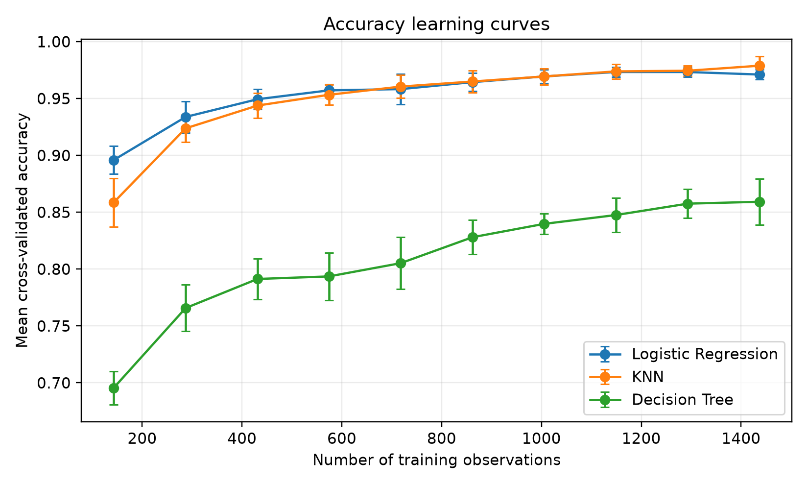
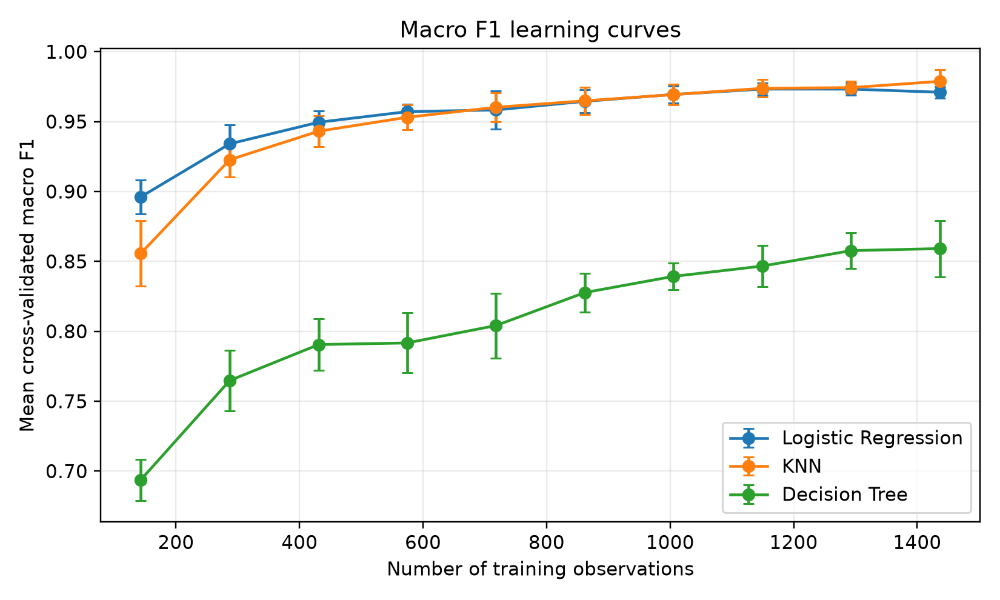
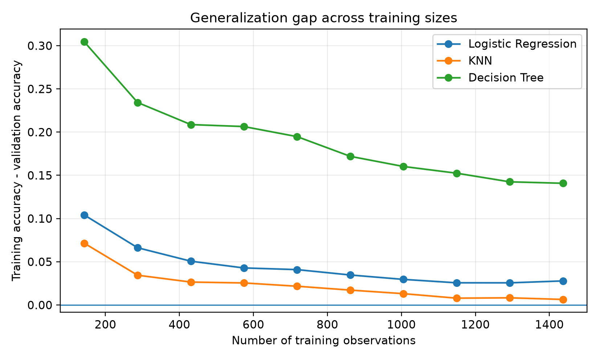

# 🔢 Learning to Generalize

### How much does another batch of examples help?

A classifier can memorize a small training set and still struggle with unfamiliar handwriting. This DASC 5420 project follows three models as their training data grows, asking when extra examples help and when the gains begin to flatten.



## The experiment

Start with 1,797 handwritten digit images, each represented by 64 pixel values. Train logistic regression, five nearest neighbours and an unrestricted decision tree on ten increasing sample sizes. Evaluate them with the same shuffled, stratified five fold split and seed 42.

Scaling stays inside the logistic regression and KNN pipelines, so validation observations cannot influence the training scaler. The tree uses the original pixels. Hyperparameters stay fixed to focus the comparison on sample size.

The largest fitting subset contains 1,437 observations because the remaining fold is reserved for validation.

## What happened?

At the largest training size, the original course experiment obtained:

| Model | Validation accuracy | Validation macro F1 |
| :--- | ---: | ---: |
| KNN | 97.89% | 97.88% |
| Logistic regression | 97.11% | 97.10% |
| Decision tree | 85.92% | 85.92% |

The repository includes the original numerical table and a fresh reproduction. Tests compare the complete reproduced score columns with those course results, rather than only checking these rounded highlights.



More examples helped all three classifiers. KNN benefited particularly strongly. The unrestricted tree kept perfect training accuracy while its validation performance lagged, illustrating overfitting.



Error bars represent one sample standard deviation across five folds. They are descriptive variation, not confidence intervals: the training sets overlap.

## Run the same study

Use Python 3.10 or later:

```sh
python -m venv .venv
# Activate the virtual environment for your shell.
python -m pip install -r requirements.txt
python experiment.py
python -m unittest discover -s tests -v
```

The dataset comes with scikit-learn, so the experiment needs no dataset download, private account or API key. The run writes two CSV tables, three plots and an environment record under results/.

Use `python experiment.py --output results/local --jobs 1` for a separate run. The tests compare the default results directory, so run the default command before testing fresh artifacts. Dependency versions used for the published run are recorded in results/environment.json.

## Reading the curve

The original diminishing returns rule finds the first sample size whose next two signed accuracy gains are each below 0.005, or half a percentage point. It identifies 718 examples for KNN and 1,005 for logistic regression; the tree does not meet the rule.

This is a descriptive heuristic. Negative gains also satisfy the original rule, so it is not proof of a stable plateau. It uses later points on the same curve and is not an online stopping guarantee.

## What this tells us

**What:** Measure how training sample size affects three digit classifiers.

**Why:** Learning curves help distinguish a model that needs more data from one whose flexibility or assumptions deserve attention.

**How:** Keep the models fixed, increase the training samples, and compare training and validation accuracy plus macro F1 across five folds.

These results concern one small benchmark and one split seed. They do not establish a universal model ranking, a formal bias and variance decomposition or performance on unseen writers. There is no independent final test set after comparing the curves. Small shuffled subsets are not individually stratified, even though the full folds are stratified.

## Explore the files

| File | Purpose |
| :--- | :--- |
| experiment.py | Runnable adaptation of the course experiment |
| results/learning_curve_results.csv | All 60 model, metric and training size combinations |
| results/diminishing_returns.csv | Original plateau heuristic |
| results/environment.json | Versions used for the current reproduction |
| docs/course_results.csv | Original course output for comparison |
| tests/test_experiment.py | Numerical reproduction and calculation checks |
| docs/provenance.md | Course origin, publication changes and disclosure |

The data and derivative summaries retain [dataset attribution](DATA_LICENSE.md). See [provenance](docs/provenance.md) for the relationship to the original course work.
